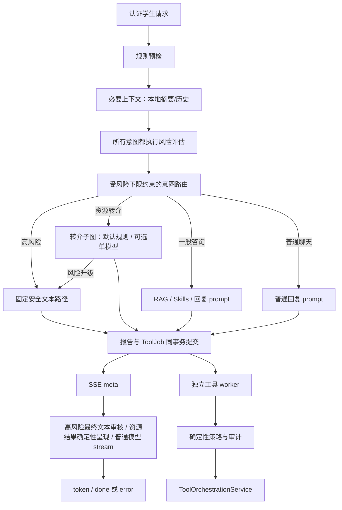
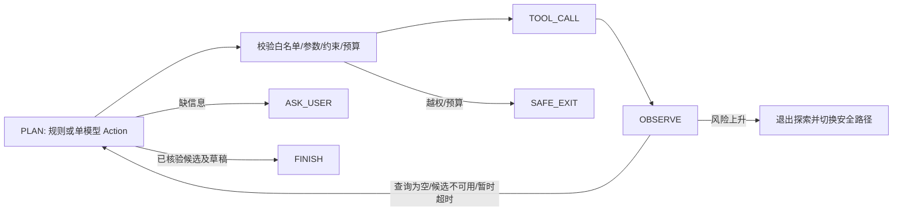

# HarborRelay 架构与验证边界

本轮基于本地提交 `f172dd833377ceda268d4a481f558be32dff9942` 升级。
实施前证据见 [审查报告](docs/ARCHITECTURE_REVIEW.md)，逐阶段修改与回归见
[实施日志](docs/IMPLEMENTATION_LOG.md)。系统提供校园心理支持工程演示，不提供临床诊断。

## 核心决策

LangGraph 保留为确定性安全主流程的执行器。转介子图默认采用显式规则规划；单模型
规划保留为有界实验选项。两者产生相同 Action，经相同代码校验后调用本地模拟工具。
规则规划不冒充模型自主决策。记忆、RAG、风险规则和副作用仍为服务。
旧 trace 中的 Agent 名称及 API 的 `agents` 字段保留兼容含义，不代表每个节点都独立自主。

|边界|改造前|改造后|
|---|---|---|
|状态|单个可变 AgentContext，含 ORM 引用|显式 TurnState 字段，节点隔离快照、结构化产物|
|自主性|完成标志驱动固定角色顺序|安全主流程保持确定性；转介默认规则反馈，模型规划实验需收益证据|
|风险|CHAT 可跳过评估，普通回复重置 LOW|全部意图强制评估，风险不可被分类降级|
|高风险回复|图外自由生成，无最终文本门禁|固定模板的最终文本先审核，拒绝/超时不发送候选|
|告警调度|完整 SSE 结束后分发|报告与 outbox 同事务，先于首个 SSE 事件|
|工具授权|治理未进入默认 worker，自由 actor|执行前策略审计、认证主体、角色与个案归属|
|Trace|默认复制完整原文和 prompt|记录有限元数据、引用、回复哈希和停止原因|
|MCP|名义接入，默认队列绕过|明确内部 Service 边界，外部未认证写入拒绝，P5 暂缓|



普通低风险聊天没有心理报告，但仍强制进行风险检查。已有咨询报告、风险个案、
Excel/告警路径保留。高风险命中可以省略可选历史、RAG、Skill 加载和自由文本生成；
这些组件故障不会阻止该分支提交 outbox。必要数据库不可用仍会阻止持久化，不能宣称
基础设施完全失效时仍能送达告警。

## 状态与结构化协作

`agents/contracts.py` 定义 TurnState、TaskSpec、ToolObservation、Artifact、SafetyReview。
图状态不含 ORM 实体或 SQLAlchemy Session；用户/会话只存 ID 和本轮必要信息。
每个节点通过隔离的工作快照复用既有服务函数，返回显式更新，不修改传入状态。
custom runtime 和 LangGraph 使用同一套转换、路由、风险与结果契约。

|契约|用途与约束|
|---|---|
|TurnState|turn_id、输入引用、强制安全结果、必要上下文、任务、观察、产物与停止原因|
|TaskSpec|仅 referral；结构化约束、步数/调用/耗时上限|
|ToolObservation|success/empty/timeout/error/denied/unknown/repeat；数据、来源和有限错误码|
|Artifact|id/kind/producer/task_id/schema_version/payload/source_refs/created_at；按 kind 校验 payload|
|SafetyReview|审查对象为 final_text，绑定 draft_id 与明确输出模式；置信度不能授权工具|
|AgentRunResult|保留原 Harness 适配边界，增加产物、turn_id、模型调用和转介结果|

有消费者的产物为 intent、risk_assessment、retrieval_evidence、referral_options、
response_draft、safety_review。reply 的实际生成发生在图之后，因此最终文本摘要与审核
产物由响应边界添加到 trace，而不是把 prompt 当成已审核自然语言。

未添加分布式事件总线、任务竞争或持久化 checkpointer。数据库 outbox 的恢复能力
不等于 Agent 可从任意推理中间点恢复。

## 缓存与向量依赖的故障边界

Redis 为可丢失会话缓存。追加消息、裁剪和 TTL 在同一事务执行；replace 也显式使用事务。
初始化 PING 失败不永久丢弃 client，同一 store 可在现有 socket timeout 对应的短暂冷却后
重连，避免同一轮连续等待多个失败请求。读取只接受 user/assistant 的字符串内容，坏条目
不会把合法同组消息一起丢弃，也不会把缓存中的 system 角色提升为 prompt 权限。
每轮先从数据库读取最近合法会话消息的完整 ID 窗口（按主键排序，避开同时间戳歧义），
缓存每条消息携带提交后的 `messageId`。只有完整 ID 序列匹配，才使用缓存正文；中间丢写、
重复、乱序、旧回填或旧格式均回读该窗口的持久消息并脱敏重填。命中时只从数据库读取
有界 ID 列，正文来自 Redis。无需 DB/Redis 分布式事务、版本新表或 Lua 协议。

保证范围是当前数据库事务可见的追加式消息窗口，不是线性一致聊天：查询之后发生的提交
在下一轮读取；MySQL REPEATABLE-READ 下遵循事务快照。若将来支持同 ID 正文编辑，须同步
增加内容版本/失效机制。Redis 事务不保证运行时命令错误回滚；重复缓存写虽可能发生，
但无法通过窗口校验。高风险直接命中仍跳过可选历史读取，风险规则/授权不信任缓存状态。

Chroma 保留 0.5.23、原 provider/model 集合隔离、768 维 nomic 接口与 BM25 降级边界。
可选向量失败继续词法检索；必需向量失败明确抛错，包括 required=true 但 enabled=false
的冲突配置。向量缓存及 provider 响应不接受 NaN/Inf，序列化也拒绝非有限值。
provider 健康检查恢复时同步刷新 status 的 available/error，避免显示上一轮错误。
PostHog 固定为兼容旧 Chroma 调用签名的 5.4.0，匿名遥测维持关闭，不影响工具审计。

新快照导出当前集合的 ID、正文、metadata、向量，而非复制活跃 SQLite/HNSW 文件。
写入、来源替换/重建与快照使用按持久目录共享的进程内可重入锁；多个 store 实例共用锁。
快照按 256 条分页导出，记录格式、provider/model/collection、维度、数量和 SHA-256；
先写 `.partial-*`，完成后原子重命名发布。保留规则只清理已完成的新格式导出，不清理旧
文件快照、失败导出或不识别的目录。自动快照仍有全集合导出成本，后台导入应控制频率。

恢复校验全部记录与摘要，只接受匹配的模型集合，只创建新目录；失败导入留下
`.harborrelay-restore-incomplete` 标记，正常客户端拒绝打开。恢复不自动切换活动配置，
不连接 embedding 服务重新生成向量。旧快照不能直接由新入口恢复，旧目录保留供离线处理。
命令：`python -m app.services.vector_snapshots --snapshot <logical-dir> --destination <new-dir>`。

真实 Redis 7.2.14、Chroma 0.5.23 / Linux Python 3.12.13、Ollama nomic 的最终 **16/16** 项
隔离检查通过；额外 MySQL 8.0.46 **9/9** 包括两个事务按反向顺序提交消息的窗口检查。
忙写测试使用两个 store 实例、300 条跨分页向量、真实并发线程，在新进程恢复同一完整
generation；校验失败和覆盖活动目录均被拒绝。嵌入式 Chroma 仅支持单写进程，锁不保护
绕过服务直接调用 collection 的代码，也不是跨进程租约。不是业务 DB/Chroma 的统一快照，
也不承诺断电、磁盘损坏或分布式写入恢复。详见 [最终验收](docs/final-acceptance-2026-10-18/README.md)；
前一阶段失败基线见 [历史依赖验证](docs/infrastructure-validation-2026-10-18/README.md)。

## 转介子图的工具反馈循环

`REFERRAL_PLANNER=rules` 为默认值，直接复用原有 observation 驱动的回退策略，记录
`deterministic_policy`；不经 AiClient 或 JSON 解码。它仍产生 ReferralAction，并通过相同的
工具授权、风险中断、来源/完成校验和预算检查。模型失败后的回退另记 `deterministic_fallback`，
Mock 经过模型接口的策略另记 `mock_policy`，三者不混算为真实模型推理。

`REFERRAL_PLANNER=model` 保留单模型闭环实验；没有多模型在线路由。API 的历史
`ReferralAgent` 名称保留兼容，status 增加 `planner`，不会因为名称中有 Agent 就声称自治。
新默认值使现有模拟目录任务继续可用，避免每个步骤都依赖已知不稳定的本地模型。
主流程风险评估和意图路由的模型调用未改动。评测与选择依据见
[配对对照](docs/planner-comparison-2026-10-18/README.md)。



三个工具位于 `services/referral_tools.py`：

- search_support_resources：结构化目录查询，可调整用户未明确限定的渠道。
- get_resource_availability：仅查询已观察到的资源，必须保持用户时间约束。
- prepare_referral_summary：仅针对观察到的可用候选生成可编辑草稿。

工具没有 DB、网络、预约或通知依赖。目录与结果强制标记 simulated，来源为
`fixture://support-resources/...`；unknown 不得转换成可用。隐私要求、明确限定的
渠道和时间在工具边界再次校验。模型提出外部通知等操作会得到 denied observation。
完成还需校验候选来源、可用性和草稿，不能仅凭模型输出 finish 接受虚构资源。

默认 Fixture 先查到线下候选、观察到不可用，再改查允许的远程渠道；若改变前者的
可用性，后续动作会直接转为草稿准备。不同观察产生不同动作，相关测试和评测均验证
这一分歧。缺时间可澄清，下一轮明确补时间可以从最近的请求约束继续。

默认限额为 8 次规划、6 次工具调用、15 秒本轮预算；超时最多重试一次，重复动作
不会无限执行。节点前后检查时间预算，阻塞同步调用不能强行取消；当前工具为有界
本地函数，接真实服务时还必须设计独立超时/取消。时间解析只支持明确的星期和
上午/下午/晚上，不宣称理解所有自然语言日期。

选择 model 策略时，真实 Provider 使用校验后的 JSON Action。Ollama 通过 `REFERRAL_ACTION_FORMAT=schema`
传递原生 JSON Schema；Schema 根据当前已观察到的候选、可用性与草稿限制可选参数和
完成动作。它约束输出形状和证据范围，不决定应选哪项动作，也不取代执行器的授权、
风险、来源和完成校验。普通回复不强制 JSON，OpenAI-compatible 路径保留 prompt 契约。
`REFERRAL_ACTION_FORMAT=prompt` 可以回退到只提示格式；两种模式都保留 Pydantic 与
工具执行层校验。原生格式不受支持或响应无效时显式记录 deterministic_fallback，
不会偷偷发起不受约束的第二次模型调用。

Mock 使用显式的 observation 驱动策略。2026-10-18 真实 7B 评测已暴露重复查询、错误
退出原因和故障后缺少重试等问题：Schema 合规并不代表规划正确；120 秒诊断预算下的
完成也不代表满足默认 15 秒时限。当前转介仍为实验性的模拟能力，真实模型尚未达到
已验证可用的标准。详见 [真实依赖验证记录](docs/validation-2026-10-18/README.md)。
Ollama 协议依据见 [Structured outputs](https://docs.ollama.com/capabilities/structured-outputs)。

## SSE 的实际语义

保留 meta/token/done/error 事件，meta 增加 outputMode：

|模式|发送时机与审核|
|---|---|
|model_stream|普通回复直接转发 provider 流；没有整段发送前审核的承诺|
|safety_template|高风险最终模板经 allowlist 审核后一次发送，不调用自由文本生成|
|referral_result|验证资源证据后确定性呈现，一次发送；不是实时预约，也不是生成 token 流|

没有把预生成文本逐字回放冒充实时模型生成。首 token 指标包含图执行、规划及提交
等待，评测测量的是同进程生成器延迟，不是网络传输延迟。流失败发送 error；断连、
审核不可用和生成失败记录独立停止原因。已发出的普通 token 不能撤回。

## 副作用、授权与一致性

已有 ToolJob 表充当 durable outbox：报告 flush 后入队，二者同事务 commit，并在首个
SSE 事件前完成。Excel、创建风险个案、告警执行在 worker，告警依赖个案创建成功，
不依赖 Excel 成功。工具每次执行均经过持久化报告风险策略与允许/拒绝审计。

队列按 report_id/kind 幂等，MySQL 报告行锁串行化同一报告入队；claim 使用状态/到期
条件更新，恢复只针对过期 RUNNING。依赖死亡会收敛为死信。DEAD 不因重复 enqueue
悄悄生成新任务，重放需维护操作。Excel 使用报告 ID 去重并以临时文件原子替换，覆盖
文件已写但数据库提交失败的重试窗口。默认本地单 worker；多进程共享 Excel/SMTP 的
分布式锁、租约心跳和幂等投递没有验证，不应据此直接水平扩容。

SMTP 为至少一次执行，可能在外部发送成功、事务未提交的窗口重复，不能保证
exactly-once。log 模式仅记录，不代表已发送邮件。TOOL_QUEUE_ENABLED=false 暂停
后台消费，任务仍提交到 outbox；不会静默改走 MCP。恢复默认 worker 后才会继续执行。
SMTP 的部分收件人拒收也记为 FAILED，不能因为 smtplib 正常返回就声称整体成功。
loopback 沙箱已验证成功去重、全部/部分/DATA 拒收、TLS/AUTH 拒绝、确认丢失后的重复风险
及带审计的队列重试。沙箱不会转发 `.invalid` 地址，不证明公网收件、有效证书或 TLS 成功握手。

个案 service 从认证的持久化 UserAccount 推导操作人，拒绝自由 actor 字符串。
管理员保留现有全局管理权限；ROLE_COUNSELOR 的 API 范围为自身/未分配个案，
普通学生不能访问管理端。新建个案 owner 为 unassigned，通知邮箱不再充当认证身份。
现有 Web 管理界面仍以演示管理员为入口；辅导员范围通过 API 集成测试验证。

密码补丁使用 Argon2id；旧 SHA-256 仅在成功认证后升级，不扫描或改动真实账户。
已有 String(128) 字段足够容纳新散列。回滚认证代码时必须保留 Argon2 verifier，不能
直接部署旧版仅 SHA-256 verifier。Basic Auth 协议本轮保留。

## Trace 与数据兼容

不增加/删除表或字段，也不执行真实数据迁移。复用现有 trace JSON 字段存放
task/action/observation_status/artifact_ref/model/latency/error/stop_reason、工具受控参数
与来源引用。模型调用记录实际 provider/model/latency；Ollama 非流式完成响应返回 usage
时记录实际 prompt/eval token 与加载时间，其他情况保留明确标注的字符估算。超时请求的
已消耗 token 不可知，不用估算冒充完整计费或资源消耗。普通 stream 仍为字符估算。
新 trace 的 original_input、sanitized_input、memory_brief、response_messages 留空，
只保存回复哈希和长度，不复制完整聊天、内部推理或密钥。有限证据以引用保存。

历史 trace 没有被清理；业务 ChatMessage/心理报告继续按原业务策略保存原文。
清理历史数据、加密和保留期策略需要单独的部署与数据治理方案，本轮未操作真实数据。
原 DTO/管理端字段兼容，增加的步骤元数据向后兼容。

## MCP、P3 与 P5

默认路径为 Queue → ToolOrchestrationService，没有 Queue → MCP → Service。
保留本地 stdio 协议适配器，MCP 依赖限定 1.x。未认证的接手/跟进工具明确拒绝；
报告工具仅接受 backend 子进程的单报告 scope。这个本地进程范围标记不是外部身份认证，
不能据此开放远程 MCP。投递失败通过工具错误报告，不冒充成功。

没有真实第二 AI 客户端，P5 暂不实施；没有单 Agent 上下文职责失败及双 Agent 消融
收益证据，P3 暂不实施。当前不增加额外模型路由、独立研究 Agent 或跨客户端业务集成。

## 可复现证据与验收范围

Python 3.11 的 Mock 验证（无需 MySQL/Redis/Ollama/SMTP；不安装可选 Chroma）：

```powershell
uv venv --python 3.11 .venv
uv pip install --python .venv/Scripts/python.exe -r requirements-test.txt
$env:PYTHONIOENCODING = 'utf-8'
.venv/Scripts/python.exe -m unittest discover -s tests -v
.venv/Scripts/python.exe -m app.harness.runner --suite all --json
.venv/Scripts/python.exe -m app.evaluation.runner --baseline-ref f172dd8 --repeat 3
```

runner 使用 git archive 构造只读旧代码快照，使用隔离临时 SQLite/模拟账户，强制
Mock、禁用向量库且告警为 log；不加载真实数据库或发送邮件。报告见
`target/evaluation/report.json`、`report.md`、`failures.json`、`current.json`、
`baseline.json`、`referral-scenarios.json`。本轮保存的运行证据在
[docs/evaluation](docs/evaluation/report.md)，包含环境版本与各阶段 harness。

对照使用相同合成输入/Mock 配置/运行次数。旧版没有转介循环，完成差异表示能力
覆盖，不表示模型智能提升；故障场景在旧版标为不支持。安全失败是指定合成门槛的
失败数，不是临床风险检出率。RAG 沿用原指标定义，Recall@K 按任一相关结果命中计算。

2026-10-18 增加两个独立集成探针：

```powershell
# 仅调用已安装的本机 Ollama；默认预算与生产配置一致
.venv/Scripts/python.exe -m app.evaluation.ollama_runner --budget-seconds 15 --repeat 3
# 只用于诊断规划问题，不修改生产时限
.venv/Scripts/python.exe -m app.evaluation.ollama_runner --budget-seconds 120 --cases available replan missing_time timeout_once empty privacy unknown risk_before --output-dir target/ollama-diagnostic
# 要求本机 Docker 已缓存 mysql:8.0；不会连接项目现有数据库
.venv/Scripts/python.exe -m app.evaluation.mysql_runner
```

MySQL 探针新建带所有权标签、loopback 端口和 tmpfs 数据的容器，使用随机测试库及合成
账户，完成后仅清理自己创建的容器。MySQL 8.0.46 的 9/9 项检查通过，包括 8 线程同报告
入队、3 个并发 dispatcher 的条件认领、两个真实子进程退出窗口、策略拒绝和死依赖收敛。
并发认领检查以记录 executor 接收的 job ID 隔离 DB claim；实际业务副作用另作串行验证，
不冒充多进程分布式投递、机器断电、MySQL 重启恢复或真实 SMTP 的验证。

后续需要先证明模型在更复杂、确实需要权衡的任务上优于规则，再考虑默认启用模型规划，
避免围绕固定 Fixture 反复调提示制造收益。缓存窗口一致性、同进程忙写逻辑快照恢复与
loopback SMTP 故障沙箱已经完成；P0/P1/P2/P4 的最终清单和限制见
[最终验收](docs/final-acceptance-2026-10-18/README.md)。现有模型失败尚不能证明
独立上下文或职责拆分的必要性；没有消融收益，P3 继续暂缓。没有真实第二客户端，P5
继续暂缓。详细结果与重现限制见 [2026-10-18 验证记录](docs/validation-2026-10-18/README.md)。

缓存/向量探针入口：`.venv/Scripts/python.exe -m app.evaluation.infrastructure_runner`。
它使用缓存 Docker 镜像，在临时虚拟环境补齐当前 requirements，不修改主环境或基础镜像；
仅只读挂载源码和技能，数据保存在容器 tmpfs。模型请求使用合成文本和本机已有模型。
报告见 `target/infrastructure-validation/report.json`，版本与所有权清理结果一并记录。
